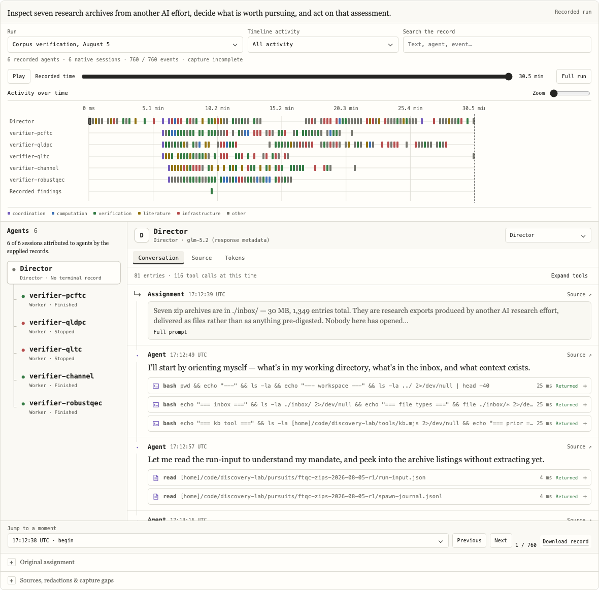

# Agent Record

A React component for reading what an agent team did: conversations, tool inputs and outputs, topology, timelines, and recorded token usage.

[Live example](https://drewstone.github.io/agent-record/) · [Research using the viewer](https://drewstone.github.io/research/bcww/#agent-record)



## Install

```sh
pnpm add https://github.com/drewstone/agent-record/releases/download/v0.5.1/drewstone-agent-record-0.5.1.tgz react react-dom
```

The release is an ESM package with TypeScript declarations and CSS.
It is distributed through GitHub Releases; this version is not published to the npm registry.
React 18.3 and 19 are supported peer versions; release verification uses React 19.

```tsx
import { AgentRecord, parseRecord } from '@drewstone/agent-record'
import '@drewstone/agent-record/styles.css'

const record = parseRecord(await response.json())

export function RunPage() {
  return <AgentRecord records={[record]} />
}
```

Your application loads the data and decides which content may be displayed.
The component makes no network requests, stores no data, starts no agents, and does not change your URL.
It can render on the server; hydration enables the interactive controls.
Use a client component when embedding it in a React Server Components application.

## Research reports

Use `ResearchReport` to read authored claims, limitations, checks, and source references alongside each play’s recorded events.
A compact play navigation opens Results, Activity, or Sources in one reading area. Search retained activity across agents, inspect readable tool inputs/results, and open exact source citations. Missing conversation capture remains explicit.
The offline `agent-record-report REPORT.json OUTPUT.html` command creates a self-contained interactive report and LaTeX document.
Reports remain separate from immutable execution records. Source search can optionally use one commissioned same-origin endpoint; offline reports make no network requests.
See [the report contract and exports](docs/research-reports.md).

## Input

`agent-record.v1` contains a run ID, title, nodes, and timestamped events.
`parseRecord(unknown)` validates the record and preserves additional metadata.
It rejects duplicate node/event IDs, invalid timestamps, parent cycles, invalid session joins, and duplicate published call IDs within an event.

Nodes distinguish agents, native sessions, and findings.
An importer can join a session to an agent with `agentId`; the viewer never infers that relationship from names or timing.
Roles and assignments are independent fields.
A parent missing from a partial capture remains unresolved.

Events carry messages, tool inputs/results, usage, or lifecycle information.
Source paths, hashes, original IDs, timestamps, publication notes, and unknown metadata remain in the downloadable record.
Missing measurements remain unknown.
An explicit zero remains zero.

See [the record format](docs/record-format.md) for the complete input rules and an example.

### Existing blog records

```ts
import { fromResearchPublication } from '@drewstone/agent-record/adapters/research-publication'

const record = fromResearchPublication(reviewedPublication)
```

This adapter accepts the blog's `research-publication.events.v1` files.
It preserves their events and source references while translating node identities into the reusable format.
It does not review, redact, or sanitize private logs.

### Agent-runtime run directories

`node tools/ingest.mjs <dir> --out record.json [--run-id <id>] [--manifest <snapshot.json>] [--native <dir>]` converts an agent-runtime run directory, including Claude Code, OpenCode, pi, Codex and Kimi conversations where the run retained them, or a bundle of native sessions (`bundle.json`). Event IDs are anchored to the stored bytes they came from (`anchor.v1`, see [the record format](docs/record-format.md#event-ids-idscheme-anchorv1)).
Each node's capture channel and every missing transcript are recorded in the output.
See [the record format](docs/record-format.md#agent-runtime-run-directories).

### Shared native sessions

Use `@tangle-network/harness-sessions` to read native Claude Code, Codex, OpenCode, Pi, Kimi and Factory sessions. Pass its normalized sessions to `fromHarnessSessions` for a browser-renderable record; pass recorded relationship facts from `@tangle-network/traces` when a workflow should draw parent edges. This projection does not parse a second native format or infer joins from names or time.

```ts
import { readerFor } from '@tangle-network/harness-sessions'
import { fromHarnessSessions } from '@drewstone/agent-record/adapters/harness-sessions'

const session = await readerFor('pi').read(ref)
const record = fromHarnessSessions([session], { recordId: 'review-1', title: 'Review' })
```

Session projection event IDs use `shared-session.v1`, not publication `anchor.v1`. Keep the existing anchored converter for published research records until the shared readers expose equivalent source locations and publication verification passes. Review raw text and paths before serving the projection publicly.

### Normalized trace spans

`fromTraceSpans` projects OpenInference/OTLP spans already emitted by `@tangle-network/traces` or the ChatGPT fleet into the same record model. `fromStoryboardSpans` projects the separate `@tangle-network/agent-eval` `Span[]` shape used by `@tangle-network/run-capsule`. Both retain recorded trace/run, span and parent-span IDs on events. Each trace or run is one session node; span containment is not treated as agent delegation. The caller can supply exact retained source locations and claim/verdict/publication references. Missing parents, conflicting session IDs and untimed spans become coverage gaps.

```ts
import { fromTraceSpans } from '@drewstone/agent-record/adapters/trace-spans'

const record = fromTraceSpans(spans, { recordId: 'fleet-review', title: 'Fleet review' })
```

OTLP projection uses `trace-span.v1` IDs; the storyboard projection uses `storyboard-span.v1` IDs. Neither claims original capture completeness. Review content and source paths before public serving. They do not replace the anchored research-publication converter. The two upstream span formats remain different; this package does not convert ChatGPT OTLP spans into run-capsule's storyboard input.

The Overview, run progress, and play charts use the live React renderers from `@tangle-network/charts`. Agent-record supplies the data, state colors, labels, links, and theme tokens; the shared package owns chart geometry, interaction, and CSS. The distributed `styles.css` includes the package's live chart stylesheet for hosts that load one renderer CSS file.

`RecordWorkGraph` draws a validated `RunRecord` as one interactive entity and evidence graph. It shows the run, agents, sessions, artifacts, precise claims, verdicts, publications, and profile versions. A dashed container edge attaches each root node to its record without claiming execution parentage. Other edges use only recorded parent IDs, page SHA-256 and claim IDs, reviewer session IDs, publication citations, and profile digests; absent targets remain unlinked. Events stay in the record viewer rather than becoming thousands of graph cards. The live run Work graph and this bundle graph share the profile canvas's pan, zoom, pinch, and keyboard engine.

```tsx
import { RecordWorkGraph, type RunRecord } from '@drewstone/agent-record'
import '@drewstone/agent-record/styles.css'

export function BundleGraph({ record }: { record: RunRecord }) {
  return <RecordWorkGraph record={record} />
}
```

## Run workspace

`dist/workspace-viewer.js` renders a play page and a run page from a same-origin run workspace API, for example the Tangle Discovery wall:

```html
<link rel="stylesheet" href="/assets/agent-record/styles.css">
<div id="agent-workspace" data-api="/api/discovery" data-mode="run" data-id="research-math-20261004system3"></div>
<script src="/assets/agent-record/workspace-viewer.js" defer></script>
```

The play page (`data-mode="play"`) answers how close the play is to its goal and its bar, for every play, from the composer's play document (`goal`, `checkers`, `standing`, `bar`, `live`, `climb`, `barSeries`, `ledger`, `findings`, `releases`). Its first screen states the goal, the standing sentence the host composed (solved or not under the current checker, named `vN` with the ruling that made it, the best release under it and the best under an earlier checker), the current check as a stage ladder with workloads passed and published releases passing, each bar metric's best comparable value or nearest candidate (✕ failing, * not comparable, ? unknown) with its distance to the bar as words and on a log track, the live or last run with its blocker and kill checkpoints, and the API-equivalent cost with its provenance (never $0 for unmetered use). Standing then draws the climb (check progress per checked release, one colour per checker, grouped by run; **Over time** puts the same marks at the minute each check ran, each run a band, with a brush strip, run chips and ←/→ stepping), what the checks said per run, each bar metric against its target on the climb's axis, the runs ledger (agent-hours by attempt outcome, best check, cost and seat), each run's team as an agent timeline, and findings grouped as verified, contradicted, undecided and unchecked claims. Releases, Runs, Findings and Setup hold the full tables, the version graph and the play's input.
The explore page (`data-mode="explore"`, `/api/discovery/explore`, `agent-workspace.explore.v1`) draws every catalogued run as one dot in a rectangle per play (a squarified treemap sized by runs; a dot's area follows its wall hours), or every agent the Lab mapped by what it said (`agent_semantics`, its clusters labelled), on one canvas that pans and zooms. A lens colours the dots: how a run ended, its research outcome with infrastructure failures counted apart, harness, credential, program, effort, behaviour cluster, or a computed column. The fleet line counts runs by outcome; Compare shows each cohort's solve rate and research-verdict rate with 95% Wilson intervals (under five, the count prints alone); Computed columns show each LLM-labelled column's agreement between two classifiers as Cohen's kappa with the disagreements one click from the agent's transcript.
The run page opens on the Lab's receipt document at `doc.receipt`. It formats the recorded outcome, chosen version, check output and hashes, deliverable links, decisions, cost and waste. The drawers hold the timeline, version check matrix and score line, team and lineage, tool errors, and brief. It performs no ranking or numeric aggregation. A missing document says not recorded. Print and static HTML use the same `RunReceiptView` component.
In Conversations, the selected agent's attempts sit under the replay as beads on a string, zoomed to the agent's own life: each bead is an attempt where it ended, coloured by outcome (ok, quota, rate limit, OOM, lost, refused, aborted), and clicking one replays the conversation to that moment. Now's check-progress chart draws one series per checker, named by the ruling that made it, on the check's stage names, so an amended check's first low score never reads as the work regressing; the team timeline draws each agent's attempts as ticks.
The run overview’s **Trace waterfall** drawer loads the retained record on demand and renders the shared `@tangle-network/charts/react` FlowWaterfall. It polls while the run is alive, with nested recorded agent and span identities, paired tool intervals, search and playback. Native response usage excludes cumulative lifecycle meters. Message-only model captures remain approximate observations; missing generation duration and partial pricing stay explicit.

Every detail is one click from the section it supports, as a detail view with a bar back to the overview (`?section=`): Conversations (a rail of the run's agents beside the selected agent's conversation, timeline and usage), Versions (the commit graph), Profiles (the profile graph), Outputs, Readout, Spend ledger, Findings, Graph, Assessments, Capture and Input. Findings lead with what the run found (`agent-workspace.findings.v1`): each agent's stated answer, then its results and claims; the overview links them only for a research run with no release bar. Graph lays each agent's results, claims and checks on its own lane in writing order, the papers they cite above, with an edge wherever one page names another (`findings.links`) or cites a paper (`citedBy`).
The outputs view lists each deliverable the readout names (its bar, present or missing, a published copy) with the files under it, then the declared folder's other files, and draws a selected file by its kind: Markdown as a document (a link to another delivered file opens it), images inline, CSV and TSV as a table, JSON pretty-printed, and code, HTML and anything else as numbered text. Nothing a run wrote is executed: HTML is shown as source, and a model is "not runnable here" with the reason, so no editable inputs are offered. A run that ended without its deliverable points to its brief as its readable result.
On the play page the inspector also shows what the output changed from the version before: deliverable by deliverable (matched by the readout's id), which files were added, removed or changed by content hash, each changed text one click from its line diff and each changed image drawn before and after. It is a comparison of the delivered files, not a measured effect.
When the brief says what an agent is doing, that line sits under the agent's row, labelled as the observer's words.
Every score sits on the readout's absolute 0–100 vs world-class scale, side by side per category: the readout's AI judges (advisory unless calibrated, and "retired scale" for a judge that used the old relative 0–4 scale), the AI persona panel (`finalOutput.panel`: median, range and count) and each person's latest grade (`finalOutput.grades`). The table appears in the readout drawer and the version inspector, and the answer strip shows the AI judges' median, or the personas' median when no judge used the absolute scale. The readout's charts (`readout.charts`) are drawn in the readout drawer and the outputs view, and the version inspector pairs two versions' charts before and after: the same chart where both drew it, else charts of the same unit.
The readout drawer also shows the run's latest trace review (`finalOutput.traceReview`, discovery-lab `runner/trace-review.mjs`): the requester's goal, whether it is a live review or the final one written after the run settled, how many agent sessions the reviewing model read and how many it could not, and one row per question in plain words with its 0–100 score (higher is better), verdict, or the failure of a question it could not answer; each row's quotes from the agents and suggestions fold under it. A run without a review shows no section.

### Theatre page

`data-mode="theatre" data-id="<theatre>"` draws a theatre's hill-climb from `GET <api>/theatres/<id>` (`{schema: "discovery-lab.theatre-views", theatre, bars: [view, ...]}`, each bar the Lab's `bar-<digest>/view.json`, oldest first; discovery-lab `docs/theatre.md`). With no id it lists the theatres from `GET <api>/theatres`. The page draws only what the views state:

- The header names the best round so far and the bar it was scored on, then says which newer bars have no round with a reading yet.
- One panel per bar, because a new bar is a new staircase. x is the theatre's acts in time, in equal columns; inside a column the rounds run in the order they were tagged. y is the checks a round passed, out of the bar's checks.
- Every round is a dot: accepted steps up filled, rejected hollow, rounds that broke a rule of the gate crossed, judge-only gains inside the noise dimmer, rounds of an earlier act that this bar read dashed, and a round with no complete reading as a tick on the baseline. The best-so-far line follows the accepted steps; a dashed edge joins a play's first round to the round it forked.
- Under each column sits its act: the one change it made, how it came out on this bar, and its cost as the API-equivalent figure beside the billed one. An unknown figure reads `unknown`, and a sum with a missing part reads `at least`.

The model is `src/workspace/theatre.ts`, which places rounds and edges from the views and scores nothing.

When the selected version ran an optimizer search (the profile index's `searches`, with `proposed` versions), the play page shows it below the graph: the claim it made (shipped, with the held-out test effect and its interval), the best selection score against evaluation spend, a replay over the search's clock, and every proposed version as a tree with its operator, decision, selection score, the paired effect on its parent drawn as an interval and its proposal and evaluation cost. Selecting a version shows the optimizer's quoted reason, its train, selection and test scores, its decision, the diff from its parent and its prompt blame (which version introduced each line).
A page served by a writer (`me` says `{writer: true}`, from the host's tailnet identity check) adds a one-tap grade: tap the 0–100 track, add an optional comment, and Save posts `runs/<id>/grades` with the target (the run, a deliverable or a file). Elsewhere no write control appears. Under Conversations, the agents are a tree on one time axis (the rail and the conversation both stay in the window as the page scrolls): outcome, when each agent ran, time, tokens, list price, capture and adverse assessment flags. Selecting a row opens that agent in the drawer, with its conversation, timeline, usage, spend, assessments, input and coverage, and a replay over its own events.
The page draws from the record's node list (`runs/<id>/record?part=nodes`: every node, no events, and `nodeStats` per agent with its event count, time span, token usage, list price, tool calls, latest words and profile digest) and loads one agent's events when it is opened (`runs/<id>/record?node=<agent>`). A run with a 5 MB record opens as fast as a small one.
A readout not yet written reads "Readout pending"; a missing number reads "unknown", never 0, and only absolute http(s) links are followed.
The run page's Versions section draws `runs/<id>/versions` (`agent-workspace.version-graph`): every version the run's agents wrote, newest first, one lane per branch (`main`, the shared store, and one per worker), merges joining a worker's write into main, and the profiles the run spawned in the same graph. Release candidates list their scores (exact checks, held-out checks, open blockers, judge), the tag the registered rule picks, and regression and suspected judge-gaming flags; selecting a version shows its files, message and checks, and opens the conversation of the worker that wrote it. The play page draws its versions with the same graph.

Every AgentProfile value on the Input, Profiles and Versions pages (name, version, digest, model, harness, reasoning effort, credential, system prompt, each instruction, tools, skills, a profile description and the names a collapsed runtime-profile card sums up) is a `CollapsibleValue`: a value of at most 240 characters shows as it is, a longer one shows its first 240 characters and `show full (N chars)`, and the toggle expands the whole value in place as a pre-wrap block (`collapse (N chars)` closes it). A digest keeps its short form (19 or 23 characters) and states its 71. Each page has Expand all and Collapse all (`ValueScope`, `ValueControls`), hidden while the page has no long value; a profile selected after Expand all opens expanded. The run input carries the profile's whole `systemPrompt` and `instructions` beside `systemPromptSha256`; both are optional, so a document composed before the host sent them still reads.
It reads `plays/<id>`, `plays/<id>/profiles`, `runs/<id>`, `runs/<id>/record`, `runs/<id>/versions`, `runs/<id>/profile-change/<commit>`, `runs/<id>/assessments`, `runs/<id>/source/<sha256>`, `runs/<id>/page/<sha256>`, `runs/<id>/final/<path>` and `dimensions` under `data-api`; the shapes are the schemas in `@drewstone/agent-record/workspace` and `/assessment`.
The Overview's 30-day lost agent-hours KPI covers all catalog runs started in the stated UTC window. Beside the daily runs chart, it stacks lost hours by the five largest causes plus other and shows lost hours divided by all runs started each day. Days without a start have no per-run rate. The 7/14/30-day selector changes these charts while the KPI retains its stated 30-day scope.
Page state lives in the URL (`?tab=&v=&profile=&run=&show=` on a play, `?q=&program=&sort=&show=` on the plays index, `?node=&view=&file=&drawer=&event=&tab=&t=&dim=` on a run, where `section` picks a detail view and no `section` is the overview; older `view=readout|outputs`, `tab=` and `node=` links still land on the matching view), and a running run polls every 3 seconds.
When the host supplies `execution`, the top of the run page states whether it is running, its last activity and failed attempts, or its settle kind, ending error, last driver error and classification, and known-failure fix. It states whether the source sandbox is preserved and supplies the host's resume command. Conversations then reads `runs/<id>/transcript?node=<id>&limit=200`: a bounded tail of the root or selected child's append-only stream, even before a captured record is ready. It polls by `after=<seq>` every 3 seconds while alive, drains final pages and stops at settlement. Load older pages uses `before=<seq>` while append polling continues; Latest returns to the tail. Requests carry the returned `generation`; `reset` replaces the window when the host's cursor changes. The browser retains at most 2,000 stream rows. Root runtime events and native child part updates render through the existing Conversation component, using the same native-part projection as retained ingest. Reasoning starts collapsed. A settled overview does not fetch transcript files, and a settled conversation loads only its requested page. Settled archived runs with a ready record retain captured Conversations without fetching streams. An agent whose directory has no stream falls back to its captured conversation. Hosts without `execution` retain the captured-record Conversations view.
The plays page also shows the last seven days' run reliability from `reliability` (discovery-lab `tools/reliability.mjs`, `discovery-lab.reliability.v1`): the share of settled runs that ran clean (below 80% in the failure colour), each day's share and run count, and the top three causes still happening (seen in the last 48 hours), most runs lost first, each with its layer, owner and when it was last seen. A cause that topped the week but stopped days ago is not listed as live.
Tests and smoke runs, failed runs and archived runs are hidden until `show=all` ("Show them"), and the page counts what it hides, failures first; the host decides each run's and play's `hidden` reason, the viewer never guesses it.
A document the host serves as last composed while it recomposes it (`X-Workspace-Stale: 1`) is fetched again after 2.5 s, backing off, for about a minute.
An agent of a live run without a terminal state reads `working`; one whose status says `done` with no recorded usage reads `done · no usage recorded` (and `; capture missing` when its conversation was not captured); an agent with no recorded event says so in place of an empty conversation.
Theme tokens come from the host: `--ar-background`, `--ar-surface`, `--ar-raised`, `--ar-line`, `--ar-foreground`, `--ar-muted`, `--ar-faint`, `--ar-accent`, `--ar-frame`, `--ar-ok`, `--ar-warn`, `--ar-crit`, `--ar-font` and `--ar-mono`.

The conversation list renders only the rows near its viewport, so records with tens of thousands of events stay responsive.

## Interaction and embedding

The viewer includes a recursive agent tree, scrollable activity timeline, conversation, source inspector, and usage plots.
Tool inputs and results are paired by the original node ID and call ID, within one run.
Repeated call identities are marked ambiguous; a missing result is not treated as success.
A result returned before its call's recorded timestamp stays visible, with its timing discrepancy labeled.

Replay supports adjustable speed, recorded time, event steps, and reduced motion.
The time cursor hides future content in conversation, source details, and tooltips.
Usage plots distinguish input, output, cache read, and cache write counters.
Tool return time is the observed call/result interval, including queue and tool time; it is not model latency.
Recorded order follows the supplied event array.

```tsx
import { useState } from 'react'
import { AgentRecord, type RecordSelection, type RunRecord } from '@drewstone/agent-record'

function ControlledViewer({ records }: { records: readonly RunRecord[] }) {
  const [selection, setSelection] = useState<RecordSelection>({
    runId: records[0].runId,
    eventId: 'an-original-event-id',
    view: 'source',
  })
  return <AgentRecord records={records} selection={selection}
    onSelectionChange={setSelection} theme="dark" />
}
```

| Prop | Meaning |
| --- | --- |
| `records` | Readonly array of validated `RunRecord` objects; run IDs must be unique. |
| `selection` | Controlled run, node, event, time cursor, and tab. |
| `defaultSelection` | Initial selection when the component owns its state. |
| `onSelectionChange` | User selection callback; use it to implement URLs or persistence. |
| `theme` | `auto`, `light`, or `dark`; defaults to the system theme. |
| `className` | Additional class for host styles. |

`RecordSelection` has `runId`, optional `nodeId`, `eventId`, `at`, and `view` (`chat`, `source`, or `usage`).
Omit `at` to show the complete record.
Pass new immutable record objects when evidence changes.
Several viewers can share a page without sharing state or DOM IDs.
The example includes a second-instance toggle.

Import CSS once.
All selectors are scoped to `.agent-record`; it does not restyle the surrounding page.
Override `--ar-background`, `--ar-foreground`, `--ar-font`, and `--ar-mono`, or the semantic tokens in [styles.css](src/styles.css).
A host with a sticky header of its own sets `--ar-sticky-top` (default 8px) so the topology column and the profile detail stick below it.
Text uses one scale of three sizes: `--ar-text-s` (15px: labels, chips, axes, table headers), `--ar-text-m` (17px: body, tabs, table cells) and `--ar-text-l` (26px: titles); override them together to scale the viewer.

## Run the example

```sh
pnpm install --frozen-lockfile
pnpm build
pnpm dev
```

The example uses reviewed records from the research site.
Redactions and excerpts are labeled; the original discovery capture is incomplete.
Open a record file to inspect your own data entirely in the browser.

## Release checks

```sh
pnpm install --frozen-lockfile
pnpm build
pnpm typecheck
pnpm test
pnpm build:example
pnpm pack
```

This repository is public. Keep evidence screenshots and recordings in private storage and describe them in the pull request; never commit them under `docs/evidence`. Never commit a tailnet address (a Tailscale `100.x` IP or a `ts.net` name). `tests/public-repo.test.mjs` refuses both.

[Consumer evidence](docs/evidence/README.md) covers the built package, browser interactions, source preservation, server rendering, and the blog integration.
The conversation renders only the rows near its viewport.

Extracted from [Drew Stone's research site](https://github.com/drewstone/drewstone.github.io) at `95e0aaf`.
Code is MIT licensed.
Example records retain their source references and publication notes; upstream papers and excerpts retain their original rights.

## Run receipt

`RunReceiptView` renders the Lab's `discovery-lab.run-receipt` document. RunOverview reads that same object at `doc.receipt`; it formats recorded values and never chooses a version or reconstructs a missing measure.
Use `print` to open the receipt's drawers and show commands instead of action buttons.
`renderRunReceipt` from `@drewstone/agent-record/receipt` uses the same component to produce shareable static HTML.
Supply the package stylesheet through its `css` option. The workspace standalone bundle accepts `data-mode="receipt"` and `data-id="runId@tag"`.

The fixture-to-DOM browser check is `node --test tests/run-receipt.browser.mjs` after a build, with `PLAYWRIGHT_MODULE` pointing to the installed Playwright module. `RECEIPT_EVIDENCE_DIR` retains desktop/phone captures in both themes outside the public repository.
